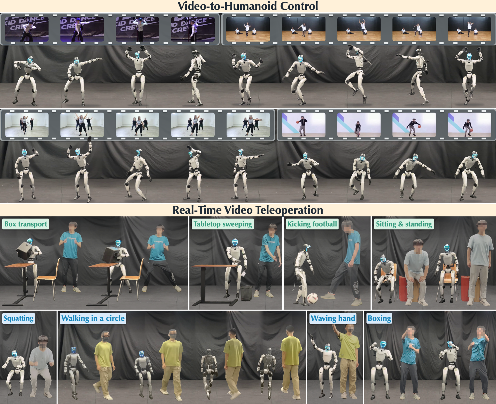

<div align="center">
<h1 style="border-bottom: none; margin-bottom: 0px ">ViT-H: Generative Video-To-Humanoid Control with Motion Tracking Feedback</h1>

[**Zimo He**](https://mileret.github.io/)<sup>&ast;</sup> · [**Tianyi Bian**](https://pku.ai/author/tianyi-bian/)<sup>&ast;</sup> · [**Zizhong Yang**](https://pku.ai/author/zizhong-yang/)<sup>&ast;</sup> · [**Hongjie Li**](https://awfuact.github.io/)<sup>&ast;&dagger;</sup> · [**Nan Jiang**](https://jnnan.github.io/) · [**Jieming Cui**](https://jiemingcui.github.io/) · [**Baoxiong Jia**](https://buzz-beater.github.io/) · [**Yizhou Wang**](https://cfcs.pku.edu.cn/wangyizhou/)<sup>&ddagger;</sup> · [**Siyuan Huang**](https://siyuanhuang.com/)<sup>&ddagger;</sup> · [**Yixin Zhu**](https://yzhu.io/)<sup>&ddagger;</sup> 
<br>
&ast;Equal Contribution&emsp;&dagger;Project Lead&emsp;&ddagger;Corresponding Authors&emsp;

<a href='https://arxiv.org/abs/2610.32966'></a>
<a href='https://awfuact.github.io/vit-h/'></a>
<a href='https://youtu.be/j3q7f4-EUpk'></a>
</div>



This is the official implementation of <i>ViT-H: Generative Video-To-Humanoid Control with Motion Tracking Feedback.</i>

## Plans

- [ ] Release code for offline video-to-humanoid control by November 1.
- [ ] Release code for humanoid video teleoperation by December 1.

## Citation

If you find ViT-H helpful, please consider citing:
```bibtex
@article{he2026vith,
  title={ViT-H: Generative Video-To-Humanoid Control with Motion Tracking Feedback},
  author={He, Zimo and Bian, Tianyi and Yang, Zizhong and Li, Hongjie and Jiang, Nan and Cui, Jieming and Jia, Baoxiong and Wang, Yizhou and Huang, Siyuan and Zhu, Yixin},
  journal={arXiv preprint arXiv:2610.32966},
  year={2026}
}
```