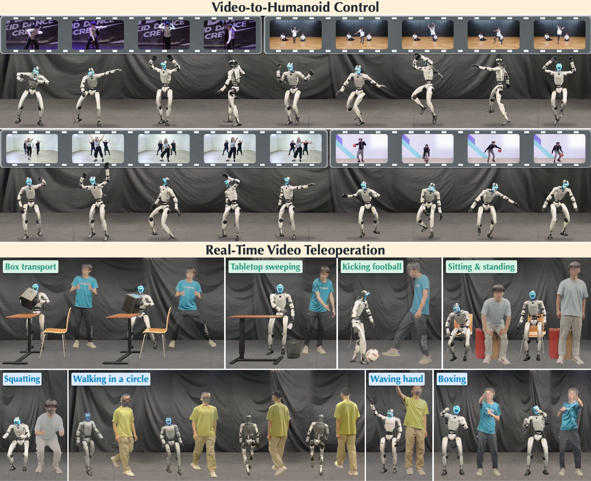

<div align="center">
<h1 style="border-bottom: none; margin-bottom: 0px ">ViT-H: Generative Video-To-Humanoid Control with Motion Tracking Feedback</h1>

[**Zimo He**](https://mileret.github.io/)<sup>&ast;</sup> · [**Tianyi Bian**](https://pku.ai/author/tianyi-bian/)<sup>&ast;</sup> · [**Zizhong Yang**](https://pku.ai/author/zizhong-yang/)<sup>&ast;</sup> · [**Hongjie Li**](https://awfuact.github.io/)<sup>&ast;&dagger;</sup> · [**Nan Jiang**](https://jnnan.github.io/) · [**Jieming Cui**](https://jiemingcui.github.io/) · [**Baoxiong Jia**](https://buzz-beater.github.io/) · [**Yizhou Wang**](https://cfcs.pku.edu.cn/wangyizhou/)<sup>&ddagger;</sup> · [**Siyuan Huang**](https://siyuanhuang.com/)<sup>&ddagger;</sup> · [**Yixin Zhu**](https://yzhu.io/)<sup>&ddagger;</sup> 
<br>
&ast;Equal Contribution&emsp;&dagger;Project Lead&emsp;&ddagger;Corresponding Authors&emsp;

<a href='https://arxiv.org/abs/2610.32966'></a>
<a href='https://awfuact.github.io/vit-h/'></a>
<a href='https://youtu.be/j3q7f4-EUpk'></a>
</div>



This is the official implementation of <i>ViT-H: Generative Video-To-Humanoid Control with Motion Tracking Feedback.</i>

## Plans

- [x] Release code for offline video-to-humanoid control.
- [ ] Release code for humanoid video teleoperation by December 1.

## Installation

The offline release targets Linux, Python 3.10, CUDA 12.1, and PyTorch 2.3.

```bash
conda create -n vith python=3.10 -y
conda activate vith
pip install -r requirements.txt
pip install -e .
```

SAM3D preprocessing and inference require
[Fast-SAM-3D-Body](https://github.com/yangtiming/Fast-SAM-3D-Body). Clone it
into `third-party/Fast-SAM-3D-Body` and follow its environment setup guide:

```bash
mkdir -p third-party
git clone https://github.com/yangtiming/Fast-SAM-3D-Body.git \
  third-party/Fast-SAM-3D-Body
bash third-party/Fast-SAM-3D-Body/setup_env.sh
conda activate fast_sam_3d_body
```

The SAM3D weights are distributed by the SAM3D project rather than in the
ViT-H checkpoint repository.

DPVO camera estimation is optional. To enable `--use-dpvo`, install
[DPVO](https://github.com/princeton-vl/DPVO) under `third-party/DPVO`:

```bash
git clone --recursive https://github.com/princeton-vl/DPVO.git \
  third-party/DPVO
wget https://gitlab.com/libeigen/eigen/-/archive/3.4.0/eigen-3.4.0.zip \
  -O /tmp/eigen-3.4.0.zip
unzip /tmp/eigen-3.4.0.zip -d third-party/DPVO/thirdparty
pip install ./third-party/DPVO
```

## Pretrained Models

Create the checkpoint root:

```bash
mkdir -p inputs/checkpoints
```

Download SMPL and SMPL-X from their official websites after registration:
[SMPL](https://smpl.is.tue.mpg.de/) and
[SMPL-X](https://smpl-x.is.tue.mpg.de/). Place the files as follows:

```text
inputs/checkpoints/
└── body_models/
    ├── smpl/
    │   └── SMPL_{GENDER}.pkl
    └── smplx/
        └── SMPLX_{GENDER}.npz
```

The ViT-H checkpoint repository contains the released offline model, YOLO,
ViTPose, HMR2, and the optional DPVO weights. Download it into the project root
so that the files follow this layout:

```text
vith_offline_g1.ckpt
inputs/checkpoints/
├── dpvo/
│   └── dpvo.pth
├── hmr2/
│   └── epoch=10-step=25000.ckpt
├── vitpose/
│   └── vitpose-h-multi-coco.pth
└── yolo/
    └── yolov8x.pt
```

The released configuration uses SAM3D image features. The HMR2 checkpoint is
included as an optional compatible image encoder. The SAM3D network and MHR
files are obtained through Fast-SAM-3D-Body and stay inside
`third-party/Fast-SAM-3D-Body/checkpoints/`.

## Dataset

The full training set uses AMASS, BEDLAM, BEDLAM2, Human3.6M, and BONES-SEED.
Preprocessed data for the first four sources is distributed as four compressed
archives: `amass`, `bedlam`, `bedlam2`, and `h36m`. Download the
[ViT-H training dataset](https://huggingface.co/datasets/eerrr1/ViT-H) and
extract all archives into one directory.

```bash
hf download eerrr1/ViT-H \
  --repo-type dataset \
  --local-dir /path/to/training_set

cd /path/to/training_set
for archive in amass bedlam bedlam2 h36m; do
  tar --use-compress-program=unzstd -xf "${archive}.tar.zst"
done

export VITH_DATASET_ROOT=/path/to/training_set
```

The extracted layout is documented in [docs/DATA_LAYOUT.md](docs/DATA_LAYOUT.md).
Dataset components and body-model assets may have terms separate from this
repository's code license.

BONES-SEED is available separately from its
[official Hugging Face repository](https://huggingface.co/datasets/bones-studio/seed).

## Training

The released experiment uses a 16-layer transformer with latent dimension
1024, 16 attention heads, 120-frame windows, and mixed-source batches of 32.

```bash
export VITH_DATASET_ROOT=/path/to/training_set
export NUM_DEVICES=8
export WANDB_MODE=offline
bash scripts/train.sh
```

For Slurm clusters, adjust the site-specific directives in
`slurm/train.sbatch`, export `VITH_DATASET_ROOT`, and submit:

```bash
sbatch slurm/train.sbatch
```

## Offline Inference

Model checkpoints are not stored in this repository. Pass the checkpoint path
explicitly. The released model was trained with SAM3D image features, so
inference requires both the SAM3D network checkpoint and its MHR body model:

```bash
python tools/infer_video.py \
  --video /path/to/input.mp4 \
  --ckpt /path/to/vith_offline_g1.ckpt \
  --imgfeat-encoder sam3d \
  --sam3d-ckpt-path third-party/Fast-SAM-3D-Body/checkpoints/sam-3d-body-dinov3/model.ckpt \
  --sam3d-mhr-path third-party/Fast-SAM-3D-Body/checkpoints/sam-3d-body-dinov3/assets/mhr_model.pt \
  --sam3d-root third-party/Fast-SAM-3D-Body \
  --output outputs/inference/input_g1.npz
```

Video preprocessing additionally requires the external detector, pose,
body-model, and camera-estimation assets listed in
[docs/INFERENCE.md](docs/INFERENCE.md). Use `--static-cam` only for videos with
a known static camera. Otherwise SimpleVO estimates camera motion by default;
add `--use-dpvo` to use the installed DPVO package and `dpvo.pth` instead.

## Release Contents

- `hmr4d/`: datasets, model, preprocessing, and shared utilities.
- `motion_lib/`: G1 kinematics and rotation utilities.
- `scripts/train.sh`: reproducible offline training entry point.
- `tools/infer_video.py`: end-to-end video inference entry point.
- `experiments/g1_training_set_exp1/`: resolved experiment configuration and checksums.
- `docs/`: dataset and inference documentation.

## Citation

If you find ViT-H helpful, please consider citing:
```bibtex
@article{he2026vith,
  title={ViT-H: Generative Video-To-Humanoid Control with Motion Tracking Feedback},
  author={He, Zimo and Bian, Tianyi and Yang, Zizhong and Li, Hongjie and Jiang, Nan and Cui, Jieming and Jia, Baoxiong and Wang, Yizhou and Huang, Siyuan and Zhu, Yixin},
  journal={arXiv preprint arXiv:2610.32966},
  year={2026}
}
```
